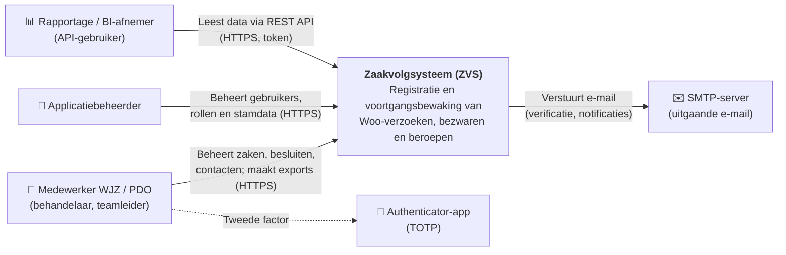
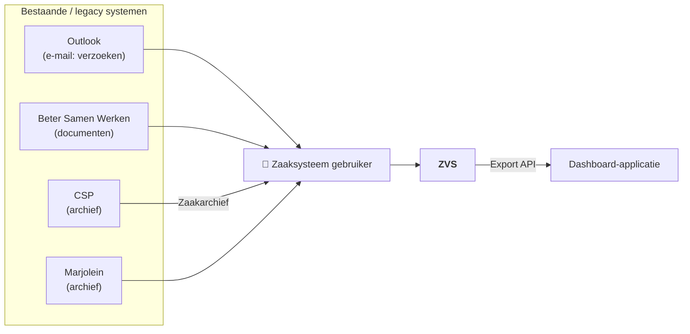
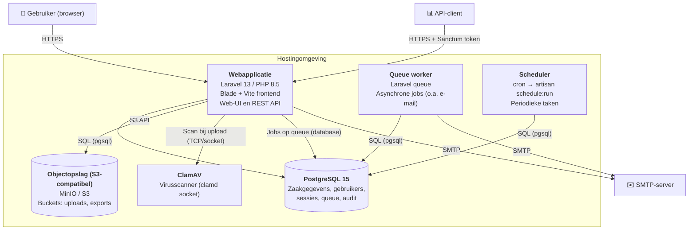
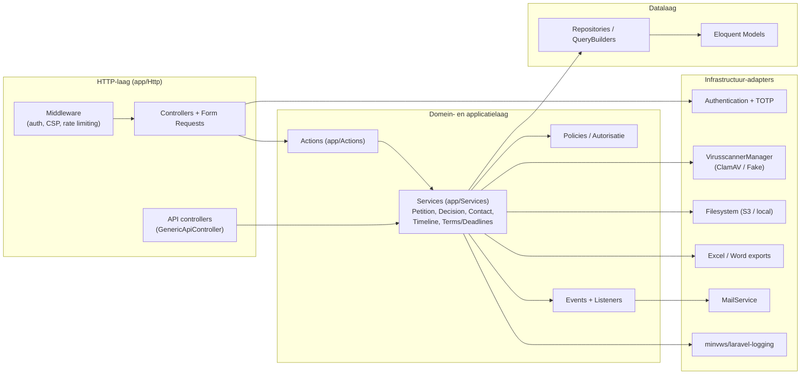
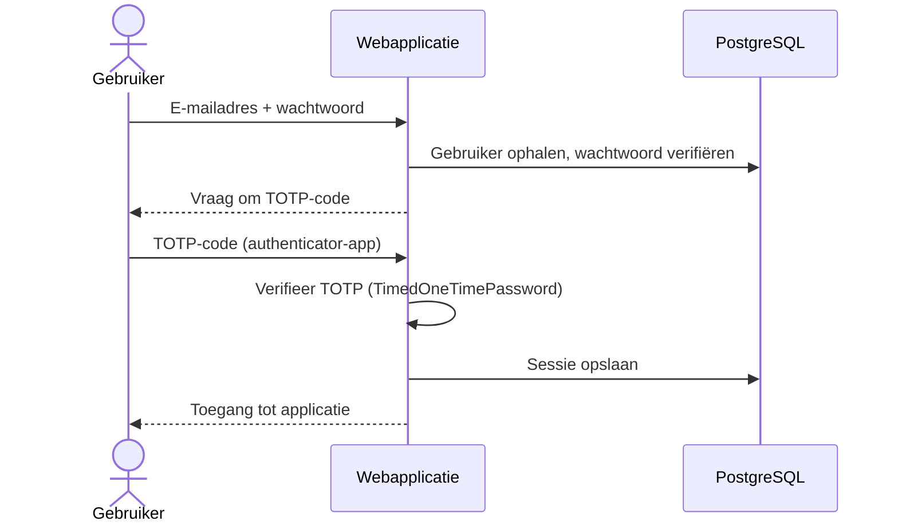
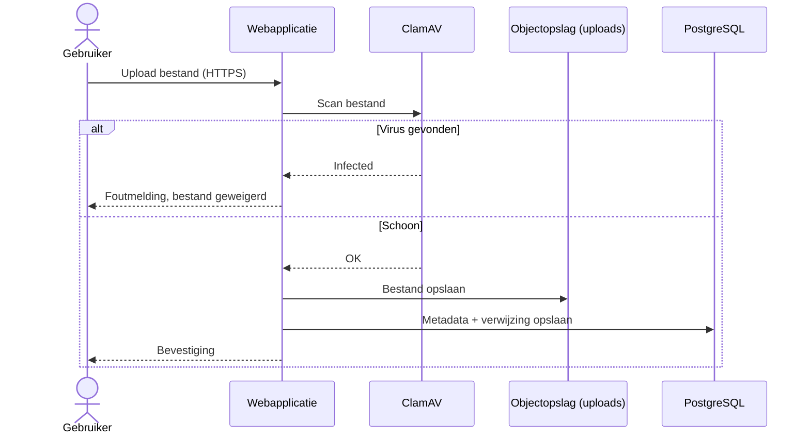

# Architectuuroverzicht

Dit document beschrijft de componenten, datastromen en integraties van het Zaakvolgsysteem (ZVS).
De opbouw volgt het [C4-model](https://c4model.com/): eerst de context (niveau 1), daarna de containers (niveau 2)
en tot slot de belangrijkste componenten binnen de applicatie (niveau 3).

## 1. Systeemcontext

| Actor / systeem          | Rol                                                                 |
|--------------------------|---------------------------------------------------------------------|
| Medewerker WJZ / PDO     | Registreert en behandelt Woo-verzoeken, bezwaren en beroepen.       |
| Applicatiebeheerder      | Beheert gebruikers, rollen, afdelingen en stamdata.                 |
| Rapportage / BI-afnemer  | Haalt gegevens op via de read-only API (`/api/v1/{table}`).         |
| SMTP-server              | Verzending van e-mail (o.a. e-mailverificatie).                     |
| Authenticator-app        | Genereert TOTP-codes voor tweefactorauthenticatie.                  |

### Applicatielandschap

| Systeem                  | Rol volgens model                                   | Status / relatie met ZVS                                 |
|--------------------------|-----------------------------------------------------|----------------------------------------------------------|
| Outlook                  | Ontvangst van verzoeken per e-mail                  | Geen koppeling; verzoeken worden handmatig geregistreerd |
| Beter Samen Werken (BSW) | Opslag van documenten                               | Geen koppeling                                           |
| Marjolein                | Archief                                             |                                                          |
| CSP                      | Zaakarchief (lezen)                                 |                                                          |
| Dashboard-applicatie     | Rapportage via Export API                           | Export API gerealiseerd als read-only API                |

## 2. Containers

| Container          | Technologie                               | Verantwoordelijkheid                                                    |
|--------------------|-------------------------------------------|-------------------------------------------------------------------------|
| Webapplicatie      | Laravel 13, PHP 8.5, Blade, Vite          | Web-UI, authenticatie, autorisatie, businesslogica, REST API.           |
| Queue worker       | Laravel queue (`database`-driver)         | Asynchrone verwerking, o.a. e-mailverificatie (`app/Jobs`).             |
| Scheduler          | Laravel scheduler via cron                | Periodieke taken, o.a. `SetPetitionTotals` (`routes/console.php`).      |
| PostgreSQL         | PostgreSQL 15                             | Primaire gegevensopslag. Schema via SQL-migraties in `database/sql`.    |
| Objectopslag       | S3-compatibel (MinIO lokaal)              | Opslag van geüploade bestanden en gegenereerde exports.                 |
| ClamAV             | ClamAV (clamd)                            | Virusscan van geüploade bestanden vóór opslag.                          |

## 3. Componenten (webapplicatie)

Architectuurregels (bijv. lagenscheiding en naamgeving) worden afgedwongen met architectuurtests in
[`tests/Architecture`](../../tests/Architecture) en statische analyse (PHPStan, PHPMD, Rector).

## 4. Belangrijkste datastromen

### 4.1 Inloggen met tweefactorauthenticatie

### 4.2 Document uploaden

### 4.3 Export maken

Gebruiker kiest exportcriteria → webapplicatie genereert Excel (`app/Exports`) of Word-document
(`config/word_templates.php`) → bestand wordt opgeslagen in de `exports`-bucket en/of direct aangeboden als download.

Exports worden via queue gegenereerd en bewaard tot de gebruiker deze verwijderd.

### 4.4 Gegevens ophalen via API

API-client authenticeert via `POST /api/login` en ontvangt een Sanctum-token → `GET /api/v1/{table}` met token →
alleen tabellen/kolommen die in `config/api_tables.php` zijn vrijgegeven worden teruggegeven (read-only).

## 5. Integraties

| Integratie          | Richting  | Protocol / techniek          | Authenticatie             | Configuratie                          |
|---------------------|-----------|------------------------------|---------------------------|---------------------------------------|
| SMTP-server         | Uitgaand  | SMTP                         |                           | `config/mail.php`, `OUTBOX_SMTP_*`    |
| Objectopslag        | Uitgaand  | S3 API                       | Access key / secret       | `config/filesystems.php`, `AWS_*`     |
| ClamAV              | Uitgaand  | clamd (socket/TCP)           | n.v.t. (intern netwerk)   | `config/virusscanner.php`             |
| REST API            | Inkomend  | HTTPS / JSON                 | Sanctum token (`ApiUser`) | `config/api_tables.php`, `sanctum.php`|
| PostgreSQL          | Uitgaand  | pgsql                        | Gebruikersnaam/wachtwoord | `config/database.php`, `DB_*`         |

## 6. Deployment

Zie [HOSTING_CHANGELOG.md](../../HOSTING_CHANGELOG.md) voor de huidige deploymentstappen.

## 7. Ontwerpkeuzes per onderwerp

### 7.1 Scheiding per afdeling (multi-tenancy)

Alle zaakinformatie hoort bij een afdeling. Gebruikers zien alleen gegevens van de afdelingen waaraan ze gekoppeld zijn.
Heeft een gebruiker rollen in meerdere afdelingen, dan kiest die een *actieve afdeling* (`ActiveDepartmentService`,
`RememberActiveDepartmentMiddleware`).

### 7.2 Autorisatie

RBAC met twee niveaus: een globale rol (`administrator`) en een rol per afdeling (`write` of `read`). De koppeling
tussen rollen en permissies staat in `config/permissions.php`. Permissies worden als Gate gedefinieerd
(`AuthorizationServiceProvider`) en afgedwongen via `can:`-middleware op routes en via policies.

### 7.3 Bijlagen

Bijlagen horen bij notities in de tijdlijn en worden vóór opslag gecontroleerd:

- extensie tegen een whitelist (`filesystems.disks.uploads.allowed_extensions`): pdf, png, jpg/jpeg, webp, docx,
  odt, md, txt, eml, msg;
- maximaal 20 MB;
- MIME-type moet passen bij de extensie;
- virusscan via ClamAV (validatieregel, dus vóór opslag).

Bijlagen worden opgeslagen in de `uploads`-bucket. In plaats van een bestand kan ook een vindplaats worden
vastgelegd (`PetitionExternalUrl`).

### 7.4 Termijnen

De uiterste datum van een zaak wordt berekend op basis van de zaaksoort, de wettelijke termijn en de geregistreerde
feestdagen (Algemene termijnenwet, `LegalTermDeadlineCalculator`, `PublicHoliday`). Gebeurtenissen zoals verdaging
en opschorting verschuiven de termijn. Bij opschorting zonder vooraf bekend einde bevriest de termijn of loopt die
door (`UnspecifiedAdjournmentMode`). Gebruikers kunnen de termijn ook handmatig aanpassen.

### 7.5 Zaaknummering

Elke zaak krijgt een uniek, leesbaar nummer in de vorm `<jaar><letter afdeling><volgnummer>`, met een volgnummer
per jaar (`PetitionNumberGenerator`). Beheerders met de permissie `petition.number.overrule` mogen een nummer
handmatig opgeven.

### 7.6 Zoeken

Zoeken gebeurt met filters op de database via query builders (`app/Models/Builder/*/Filters/SearchFilter.php`).
Er is geen full-text index en de tekst van bijlagen wordt niet doorzocht.

### 7.7 Logging en SOC

Beveiligingsrelevante gebeurtenissen (inloggen, mislukte inlogpogingen, aanmaken van gebruikers, OTP-reset) worden
gelogd via `minvws/laravel-logging`. Die logging is bedoeld voor aansluiting op het SOC van iRealisatie.

## 8. Beveiliging (samenvatting)

- Tweefactorauthenticatie (TOTP) voor alle gebruikers; accounts alleen voor toegestane e-maildomeinen (`@minvws.nl`).
- Rolgebaseerde autorisatie via policies en `config/permissions.php`.
- Content Security Policy (`spatie/laravel-csp`) en rate limiting.
- Virusscan van alle uploads.
- Versleuteling van gevoelige velden (`EncryptionService`).
- Logging conform `minvws/laravel-logging`.

Zie de PSA ([psa.md](psa.md)) voor de kaders (BIO, AVG) en [adr/](adr/README.md) voor architectuurbeslissingen.
