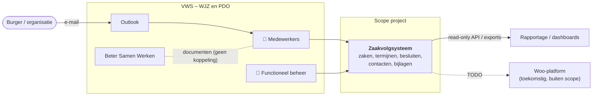

# Project Start Architectuur (PSA) – Zaakvolgsysteem

## Managementsamenvatting

Deze PSA geeft het ICT-architectuurkader voor het Zaakvolgsysteem (ZVS). ZVS is de voorziening waarmee het ministerie
van VWS Woo-verzoeken, bezwaren, beroepen en klachten registreert en behandelt, en de termijnen daarvan bewaakt.

De belangrijkste punten:

- **Kaders:** ZVS valt onder de Woo en de Awb, en verwerkt persoonsgegevens (AVG). Beveiliging volgt de BIO,
  archivering de Archiefwet. Architectuurkaders zijn de NORA, de Enterprise Architectuur VWS-Kern en de verplichte
  standaarden van Forum Standaardisatie.
- **Bijdrage aan de doelarchitectuur:** zaakinformatie die nu verspreid staat over e-mail, documentopslag en
  archieven wordt in één bronsysteem vastgelegd. Dat maakt termijnbewaking en stuurinformatie mogelijk.
- **Gevolgen voor bestaande voorzieningen:** de rol van de archieven Marjolein en CSP en van Beter Samen Werken moet
  worden vastgesteld. Er zijn (nog) geen koppelingen met het Woo-platform en met IAM (SSO).
- **Afwijkingen:** Afwijkingen van de kaders worden vastgelegd als ADR (zie [adr/](adr/README.md)).

Deze PSA beschrijft niet hoe de voorziening werkt of is gebouwd. Dat staat in de solution architectuur:
[architectuur.md](architectuur.md) en de ADR's.

## Architectuur-visie

### Organisatie en wettelijke taken

Het ministerie van VWS behandelt verzoeken, bezwaren en beroepen van burgers, bedrijven en organisaties:

| Organisatieonderdeel                             | Wettelijke taak                                                      |
|--------------------------------------------------|----------------------------------------------------------------------|
| Programmadirectie Openbaarheid (PDO)             | Behandelen van Woo-verzoeken (Wet open overheid)                     |
| Directie Wetgeving en Juridische Zaken (WJZ)     | Behandelen van bezwaar en beroep (Awb, hoofdstuk 6–8), ook bij Woo-besluiten |
| WJZ                                              | Behandelen van klachten (Awb, hoofdstuk 9)                           |

De dienst aan de samenleving: tijdige en zorgvuldige besluiten op verzoeken, bezwaren, beroepen en klachten,
binnen de wettelijke termijnen.

### De voorziening (black box)

ZVS is een webapplicatie voor medewerkers van VWS. De belangrijkste functies:

- zaken registreren (Woo-verzoek, bezwaar, beroep, klacht) en aan behandelaars toewijzen;
- wettelijke en afgesproken termijnen berekenen en bewaken, inclusief verdaging en opschorting;
- per zaak een tijdlijn, besluiten, contacten en bijlagen vastleggen;
- zoeken in zaken en overzichten van de werkvoorraad tonen;
- stuurinformatie leveren via exports (Excel, Word) en een read-only API.

### Aanleiding en knelpunten

- De werkprocessen van PDO en WJZ werden uitgevoerd met Excel, Word en e-mail. Dat is foutgevoelig en geeft geen
  overzicht.
- Zaakinformatie staat verspreid over Outlook (verzoeken per e-mail), Beter Samen Werken (documenten) en de archieven
  Marjolein en CSP. Deze systemen zijn niet gekoppeld: gebruikers up- en downloaden documenten handmatig.
- Termijnen worden daardoor moeilijk centraal bewaakt, met risico op termijnoverschrijding en dwangsommen.
- Management heeft beperkt inzicht in werkvoorraad en doorlooptijden. Bij (Woo-)rapportages moet informatie
  handmatig worden verzameld.
- De Woo verplicht tot tijdige behandeling en verantwoording van Woo-verzoeken.

### Relaties en afhankelijkheden

| Voorziening / project           | Relatie                                                                            |
|---------------------------------|------------------------------------------------------------------------------------|
| Hosting door iRealisatie        | Private cloud van iRealisatie; alleen bereikbaar via het VWS-netwerk (Haagse Ring) |
| SOC van iRealisatie             | Monitoring van beveiligingslogging                                                 |
| E-mailvoorziening (SMTP)        | Uitgaande e-mail vanuit ZVS                                                        |
| Outlook                         | Ontvangst van verzoeken; geen koppeling                                            |
| Beter Samen Werken              | Opslag van documenten; geen koppeling.                                             |
| Woo-platform                    | Mogelijke toekomstige koppeling met publicaties.                                   |
| Rapportage / dashboards         | Afnemer van de read-only API.                                                      |

## Kaders en principiële afspraken

Keuzes in het project worden getoetst aan de kaders hieronder, tijdens en aan het einde van het project.
Afwijkingen worden vastgelegd en onderbouwd in een ADR.

### Relevante wet- en regelgeving

| Wet / regeling                                                      | Betekenis voor ZVS                                                                      |
|---------------------------------------------------------------------|-----------------------------------------------------------------------------------------|
| Wet open overheid (Woo)                                             | Proces en beslistermijnen van Woo-verzoeken                                             |
| Algemene wet bestuursrecht (Awb)                                    | Bezwaar, beroep en klachten; termijnen, verdaging, opschorting                          |
| AVG / UAVG                                                          | Verwerking van persoonsgegevens van verzoekers, bezwaarmakers en contacten              |
| Meldplicht datalekken (AVG art. 33/34)                              | Incidentproces en logging moeten melding mogelijk maken                                 |
| VIR / VIR-BI                                                        | Informatiebeveiliging Rijksdienst; VIR-BI alleen bij gerubriceerde informatie           |
| Archiefwet                                                          | Zaken en besluiten zijn archiefbescheiden; bewaren en vernietigen volgens selectielijst |
| Besluit digitale toegankelijkheid overheid                          | Toegankelijkheid volgens WCAG 2.1 AA (EN 301 549)                                       |
| Agenda Digitale Overheid / Werkagenda Waardengedreven Digitaliseren | Digitale dienstverlening en informatiehuishouding                                       |

### Architectuurkaders

| Kader                                               | Toepassing in ZVS                                                                                                                                                   |
|-----------------------------------------------------|---------------------------------------------------------------------------------------------------------------------------------------------------------------------|
| Enterprise Architectuur VWS-Kern                    | Toetsing aan de VWS-principes                                                                                                                                       |
| Forum Standaardisatie – verplichte open standaarden | HTTPS en HSTS, TLS volgens de NCSC-richtlijnen, SPF/DKIM/DMARC voor uitgaande e-mail, WCAG/EN 301 549, OpenAPI Specification en NL GOV API Design Rules voor de API |
| Forum Standaardisatie – aanbevolen standaarden      |                                                                                                                                                                     |
| Cloudbeleid Rijksoverheid                           | Gehost in de private cloud van iRealisatie.                                                                                                                         |
| Open-sourcebeleid Rijksoverheid                     | Broncode wordt open source gepubliceerd; licenties via REUSE                                                                                                        |

## Visualisaties

### Target architectuur

### Applicatie en data architectuur

ZVS is één webapplicatie met een eigen database en objectopslag. De belangrijkste gegevens:

| Gegevensobject        | Omschrijving                                             | Persoonsgegevens | Bron      |
|-----------------------|----------------------------------------------------------|------------------|-----------|
| Zaak (verzoek)        | Woo-verzoek, bezwaar, beroep of klacht, met status       | Indirect         | ZVS       |
| Termijn               | Wettelijke en afgesproken termijnen, verdaging, opschorting | Nee           | ZVS       |
| Besluit               | Besluit(en) op een zaak                                  | Indirect         | ZVS       |
| Contact               | Verzoeker, bezwaarmaker, gemachtigde                     | Ja               | ZVS       |
| Bijlage               | Geüploade documenten                                     | Mogelijk         | ZVS       |
| Tijdlijn              | Gebeurtenissen en historie van een zaak                  | Indirect         | ZVS       |
| Gebruiker / afdeling  | Medewerkers, teams, rollen                               | Ja (medewerkers) | ZVS       |

ZVS is het bronsysteem voor zaakregistratie en termijnen. De solution architectuur staat in [architectuur.md](architectuur.md).

### Architectuurprincipes

| #  | Principe                                          | Rationale                                                       | Implicaties                                                                 |
|----|---------------------------------------------------|-----------------------------------------------------------------|-----------------------------------------------------------------------------|
| P1 | Security en privacy by design                     | Gevoelige (persoons)gegevens; BIO en AVG                        | 2FA, rolgebaseerde autorisatie, versleuteling, virusscan, dataminimalisatie |
| P2 | Standaard en bewezen technologie                  | Onderhoudbaarheid en beschikbaarheid van kennis                 | Laravel/PHP, PostgreSQL, S3-compatibele opslag                              |
| P3 | Open source, tenzij                               | Rijksbeleid                                                     | Open source componenten; licenties via REUSE                                |
| P4 | Eenvoud boven complexiteit                        | Klein team, beheerbaarheid                                      | Modulaire monoliet, geen onnodige gedistribueerde componenten               |
| P5 | Gegevens worden eenmalig vastgelegd               | Consistentie, NORA                                              | Stamdata centraal beheerd; exports en API lezen uit dezelfde bron           |
| P6 | Leveranciers- en hostingonafhankelijk             | Voorkomen van lock-in                                           | Gebouwd op containers; S3-API in plaats van specifieke cloudopslag          |
| P7 | Kwaliteit wordt geautomatiseerd geborgd           | Voorspelbare releases                                           | CI met tests, statische analyse, architectuurtests, SonarQube               |
| P8 | Beslissingen zijn herleidbaar                     | Verantwoording, overdraagbaarheid                               | ADR's voor significante keuzes                                              |
| P9 | Toegankelijk voor iedereen                        | Wettelijke verplichting                                         | WCAG 2.1 AA, toetsing in de ontwikkelstraat                                 |

### Relatie naar architectuurthema's

| Thema                                | Bijdrage van ZVS                                                           |
|--------------------------------------|----------------------------------------------------------------------------|
| Openbaarheid en Woo                  | Tijdige behandeling van Woo-verzoeken; verantwoording over termijnen       |
| Informatiehuishouding (Open op orde) | Zaakinformatie op één plek, gestructureerd en archiefwaardig               |
| Datagedreven sturing                 | Stuurinformatie over werkvoorraad en doorlooptijden via exports en API     |
| Informatiebeveiliging en privacy     | Afscherming van persoonsgegevens; minder informatie in e-mail en losse bestanden |
| Digitale toegankelijkheid            | Toegankelijke werkomgeving voor medewerkers                                |

### Beheer

| Aspect                  | Invulling                                                                                         |
|-------------------------|---------------------------------------------------------------------------------------------------|
| Functioneel beheer      | VWS (functioneel beheerder): gebruikers, afdelingen, stamdata                                     |
| Applicatiebeheer        | iRealisatie: doorontwikkeling, releases, incidenten                                               |
| Technisch beheer        | iRealisatie (private cloud): servers, database, back-ups, monitoring                              |
| Releaseproces           | Releasepakket met instructies per release in [HOSTING_CHANGELOG.md](../../HOSTING_CHANGELOG.md)   | 
| Exit-strategie          | Open source broncode en standaardcomponenten (PostgreSQL, S3); export van gegevens via de API     |

## Risico's

| Risico                                                          | Maatregel                                                    |
|-----------------------------------------------------------------|--------------------------------------------------------------|
| Datalek van persoonsgegevens                                    | Maatregelen uit P1, pentest, DPIA                            |
| Onjuiste termijnberekening leidt tot termijnoverschrijding      | Uitgebreide geautomatiseerde tests op de termijnberekening   |
| Migratie uit legacy-registraties levert inconsistente data op   | Migratiescripts met validatie (zie `docs/migration`)         |
| Afhankelijkheid van de hostingpartij voor deployments           | Hosting-changelog per release, reproduceerbare builds        |
| Informatie versnipperd over ZVS, Outlook, BSW en archieven      | Vastleggen welk systeem de bron is voor welk gegeven         |
